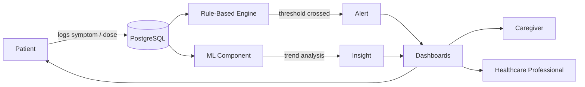

# PD Monitor: Parkinson's Disease Decision Support System

PD Monitor is a web-based decision support system that helps people living with
Parkinson's disease keep track of their symptoms and medication between clinic
visits. Patients log how they feel; the system watches those entries, raises
alerts when something looks concerning, and shares the picture with the people
supporting them: caregivers and healthcare professionals.

It combines two kinds of logic:

- a **rule-based engine** that checks every new entry against fixed thresholds, and
- a lightweight **ML component** that looks at each patient's longer-term trend
  and produces plain-language insights.

> Final-year BBIT project. The system is demoed locally with synthetic accounts;
> no real patient data is stored in the app.

---

## Who uses it

| User | What they can do |
|---|---|
| **Patient** | Sign up, report symptoms (predefined list, severity 0 to 10, optional note), keep a personal medication list and log each dose as taken or missed, view their own dashboard of entries, alerts and insights, and invite / revoke caregivers. |
| **Caregiver** | Sign up, accept or decline link requests from patients, view the dashboard of each linked patient, and log observations about them. |
| **Healthcare Professional (HCP)** | Apply for an account (held as *pending* until an Admin approves it), then view symptom history, alerts and insights for the patients assigned to them. HCPs monitor only; there is no prescribing or clinical assessment in the system. |
| **Admin** | Manage user profiles: approve or reject HCP applications, activate or deactivate patient and caregiver accounts, and assign each patient to an HCP. |

Two **system actors** work in the background: the **Rule-Based Engine** and the
**ML Component**.

---

## How it works



### 1. Patient reports data
From **Report entry** the patient picks a symptom from a fixed list of eight
motor and non-motor symptoms (e.g. tremor, rigidity, fatigue, sleep disturbance)
and rates it from 0 (none) to 10 (severe), or records a
medication dose as *taken* or *missed*. Each entry is saved with a timestamp.

### 2. Rule-Based Engine checks it immediately
As soon as an entry is saved, `app/rule_engine.py` evaluates it:

| Rule | Threshold |
|---|---|
| High symptom severity | Severity **7 or above** on a single entry |
| Poor medication adherence | **3 or more missed doses** of the same medication within **7 days** |

If a rule is triggered, an **Alert** is created and appears, in red, on the
patient's dashboard and on the dashboards of their linked caregivers and
assigned HCP. The thresholds are fixed, illustrative values agreed for this
project; they are not clinically validated.

### 3. ML Component looks at the bigger picture
The ML component (`app/ml_component.py`) runs as a separate job rather than on
every request. It compares each patient's recent severity against their own
history and stores an **Insight**, such as "symptom severity trending upward".
The next development stage uses the PPMI research dataset as a reference
baseline of typical Parkinson's progression, so a patient's trend can be
compared against it. (PPMI data is used under a data use agreement and is never
stored in this repository.)

### 4. Sharing with caregivers
1. The patient enters a caregiver's email on the **Caregivers** page, which sends
   a link request (status *pending*).
2. The caregiver sees it on their dashboard ("You have N pending link requests")
   and approves or declines it.
3. Once approved, the caregiver can view the patient's dashboard and log
   observations. A declined request can be re-sent, and the patient can revoke
   an approved link at any time.

### 5. Clinician oversight
A healthcare professional registers and waits for Admin approval. The Admin
then assigns patients to that HCP (one HCP per patient; an HCP can have many
patients). The HCP only ever sees the patients assigned to them.

---

## Security

- **Passwords are hashed and salted** with Werkzeug (`generate_password_hash`,
  scrypt). Each hash carries its own random salt, so two users with the same
  password get different hashes, and plain-text passwords are never stored.
- **Password rules** on registration: at least 8 characters, including a letter
  and a number, entered twice to confirm.
- **Role-based access**: every page checks the logged-in user's role, and data
  is scoped to the right person: caregivers only see approved links, HCPs only
  their assigned patients.
- **Account controls**: HCPs cannot log in until approved; deactivated accounts
  are blocked at login.
- **Secrets stay out of Git**: the database URL and secret key live in a local
  `.env` file, which is ignored by Git.

---

## Data model

Each user type has its own table (concrete-table inheritance, no shared users
table): `Patient`, `Caregiver`, `HealthcareProfessional`, `Admin`.

Supporting tables:

- `SymptomType`, `MedicationReference`: predefined catalogues
- `SymptomRecord`, `PatientMedication`, `MedicationLog`: what patients report
- `CaregiverLink` (pending / approved / declined), `CaregiverObservation`
- `Alert` (from the Rule-Based Engine), `Insight` (from the ML Component)

---

## Tech stack

Python 3.12, Flask 3 (Blueprints), Flask-SQLAlchemy, Flask-Migrate,
Flask-Login, Jinja2, PostgreSQL, pandas, HTML/CSS.

## Project structure

```
app/
  __init__.py        app factory, registers blueprints, loads the logged-in user
  models.py          database tables
  rule_engine.py     Rule-Based Engine (threshold alerts)
  ml_component.py    ML Component (trend insights)
  validators.py      shared form validation (password rules)
  auth/              login / logout
  patient/  caregiver/  hcp/  admin/   one blueprint per user role
  templates/         one folder of pages per role, plus base.html
  static/css/        stylesheet
migrations/          database schema history
config.py  run.py  seed.py  requirements.txt
```

---

## Running it locally

1. Create and activate a virtual environment, then install dependencies:
   ```
   python -m venv venv
   venv\Scripts\activate
   pip install -r requirements.txt
   ```
2. Create a PostgreSQL database called `pd_dss` (e.g. in pgAdmin).
3. Copy `.env.example` to `.env` and fill in your own values:
   ```
   SECRET_KEY=<a long random string>
   DATABASE_URL=postgresql+psycopg2://postgres:<your-password>@localhost:5432/pd_dss
   ```
4. Create the tables and seed the starting data (admin account, symptom types,
   medications):
   ```
   flask --app run db upgrade
   python seed.py
   ```
5. Start the app and open http://127.0.0.1:5000:
   ```
   python run.py
   ```

---

## Project status

**Working now:** registration and login for all four roles, symptom and
medication reporting, rule-based alerts, caregiver linking (request, approve,
decline, re-send, revoke), caregiver observations, HCP approval and patient
assignment, and role-specific dashboards.

**Next:** ML component with the PPMI baseline, trend charts on the dashboards,
automated tests for the rule engine and ML component.

**Known limitations:** alert thresholds are illustrative, not clinically
validated; no CSRF protection, rate limiting or email verification yet
(planned as future work).
